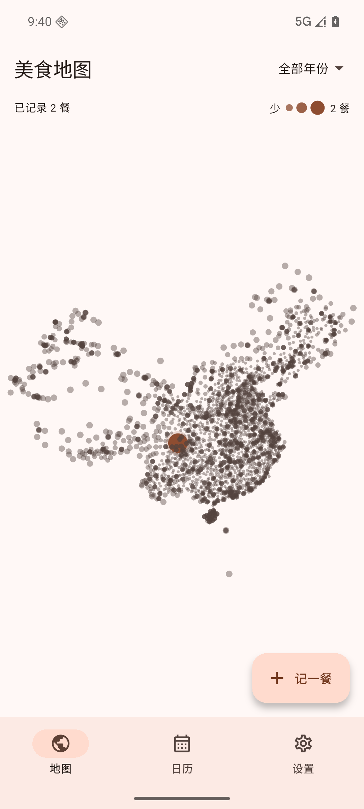
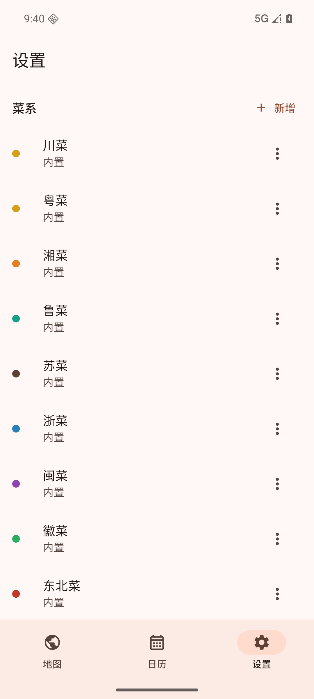

# MealMap（工作名）

记录「什么时候、在哪里、吃了什么」的个人饮食日志 App。

- **美食地图**：城市点阵按记录数量放大加深，可按年份切换。
- **美食日历**：月视图点开某天看当天记录，年视图是只读热力图。
- **完全离线**：数据在本机 SQLite，照片在 App 私有目录；不需要账号，也没有联网权限。
- **一键移机**：导出带照片的 zip，通过系统分享发到新手机后导入。

| 地图 | 日历 | 记一餐 | 设置 |
|---|---|---|---|
|  |  |  |  |

## 为什么不画中国地图的省界

《地图管理条例》要求向社会公开的地图送审，且需要测绘资质；简化、缩放标准地图也属于「编辑」，要重新送审。个人开源项目拿不到审图号，因此本项目**不绘制任何行政区域界线**：

- 372 个地级市点位可交互，按记录数量放大、加深；
- 2851 个区县点位只作背景，用来勾勒国土轮廓；
- 省份只作为分组维度出现在图例与统计里，不渲染为面。

详见 [ADR-0003](docs/adr/0003-city-dot-map.md)（取代了最初画省界的 [ADR-0001](docs/adr/0001-abstract-admin-map.md)）。

## 文档

- [v1 规格与验收标准](docs/specs/v1.md)
- [工单拆解](docs/tickets/v1.md)
- [术语表](GLOSSARY.md)
- 架构决定：[0002 Flutter 与可替换数据层](docs/adr/0002-flutter-and-replaceable-data-layer.md) · [0003 城市点阵地图](docs/adr/0003-city-dot-map.md)
- [进度与踩坑记录](PROGRESS.md)

## 技术栈

Flutter（Android 优先）· drift/SQLite · Riverpod · CustomPainter。

分层：`features/`（界面）→ `domain/`（模型、规则、仓储接口）→ `data/`（drift 实现、照片、备份）。UI 不直接依赖 drift，见 ADR-0002。

## 开发

```bash
flutter pub get
flutter test                     # 31 个测试
flutter run                      # 需要 Android SDK / 模拟器
flutter build apk --release
```

数据：`assets/data/places.json`，来源与许可见 [assets/data/NOTICE.md](assets/data/NOTICE.md)（AreaCity，MIT 声明，GCJ-02，只取名称/隶属/坐标）。

## 许可证

MIT，见 [LICENSE](LICENSE)。
